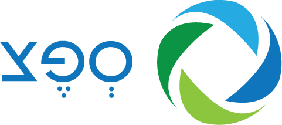
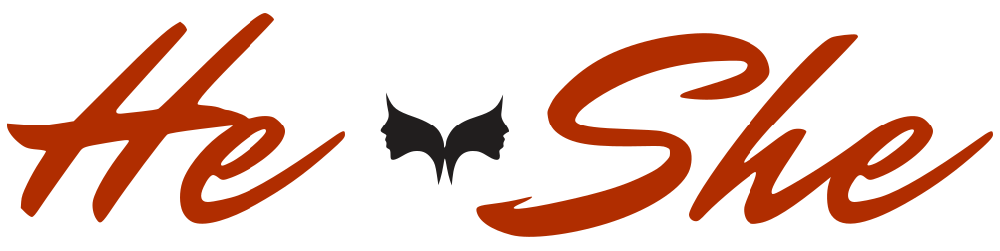
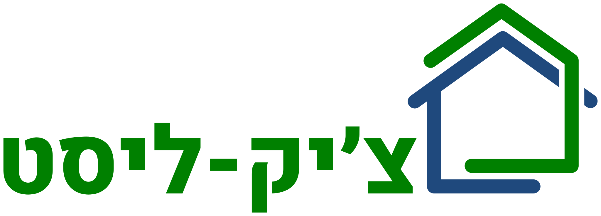
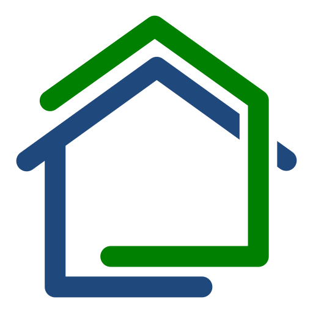
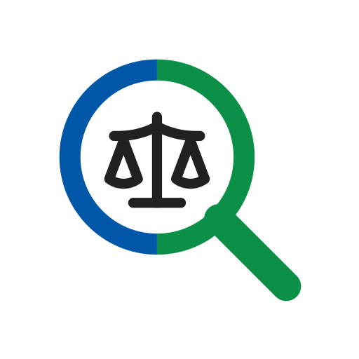
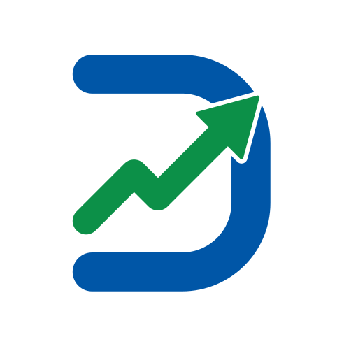
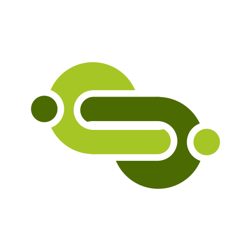
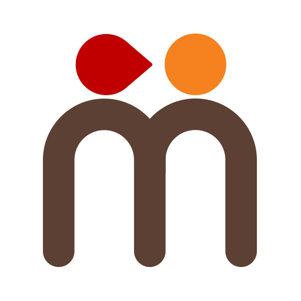

<div dir="rtl">

# Logo Design Skill

סקיל חינמי לעיצוב לוגו לעסק, בעברית. שירות מטעם Trium Technology.

הסקיל מנהל ראיון קצר על העסק, מציע סמל, צבעים ופונט לפי התחום ומפיק סט שלם של קבצי SVG נקיים (ו-PNG כשמותקן Chrome): לוגו אופקי ומוערם, סמל, אייקון אפליקציה, מילולי, גרסה לרקע כהה וגרסאות בשחור ובלבן. יש בו ספרייה של 28 סמלי קו מקוריים, ארבעה פונטים, שורת משנה, תמיכה בכתיבה מימין לשמאל ובשמות לטיניים, ותצוגה מקדימה להשוואה בין כיוונים.

## התקנה

הורידו את [spetz-logo-design.zip](https://github.com/triumtech-dev/spetz-logo-design-skill/releases/latest/download/spetz-logo-design.zip) ופרסו אותה לתיקיית הסקילים של Claude (`~/.claude/skills/`). לאחר מכן בקשו מ-Claude: "תעצב לי לוגו לעסק".

## הרצה ישירה של המחולל

דרושה רק Python 3.9 ומעלה, בלי חבילות נוספות.

```bash
python skills/spetz-logo-design/scripts/make_logo.py --suggest "עורך דין"
python skills/spetz-logo-design/scripts/make_logo.py --name "שם העסק" --tagline "שורת משנה" \
  --symbol scales --color "#1e3a5f" --accent "#b8893a" --font frank --out out --png --preview
```

- `--suggest` מציע סמלים, צבעים ופונט לפי תחום. `--list-symbols` מציג את כל הסמלים.
- `--symbol`: שם סמל, או `monogram` (ברירת מחדל) לאות פותחת בצורה לפי `--style` (`circle`, `square`, `rounded`).
- `--font`: `assistant`, `heebo`, `rubik`, `frank`. הפונטים צריכים להיות מותקנים; להדפסה מומלץ להמיר טקסט לקווים.
- הצבעים בפורמט `#RRGGBB`. `--png` דורש Chrome או Edge. `--preview` יוצר `preview.html`.

## מגבלות

- הפלט הוא נקודת פתיחה ולא תחליף למעצב מקצועי.
- לפני שימוש מסחרי יש לבדוק זמינות שם וסימן מסחרי.
- הסקיל לא כולל ולא מפיץ לוגואים של מותגים.

## דוגמאות: לוגואים של מערכות Trium Technology

לוגואים של מערכות שלנו, לצורך הצגה בלבד. הם לא נוצרו בכלי הזה ואינם מורשים לשימוש חוזר, ראו [NOTICE](NOTICE).

<table>
<tr><td align="center"><br><sub>SPETZ</sub></td><td align="center"><br><sub>trusted.zone</sub></td><td align="center"><br><sub>HeShe</sub></td><td align="center"><br><sub>homechecklist</sub></td><td align="center"><br><sub>homechecklist (house)</sub></td></tr>
<tr><td align="center"><br><sub>israelaw</sub></td><td align="center"><br><sub>calcalan</sub></td><td align="center"><br><sub>send2sign</sub></td><td align="center"><br><sub>tipul.app</sub></td><td align="center"><br><sub>botmesima</sub></td></tr>
</table>

## רישיון

הקוד ברישיון [MIT](LICENSE). השם והסימנים של Trium Technology שמורים, ראו [NOTICE](NOTICE).

</div>

## English

A free Hebrew-first skill for designing a business logo, a service by Trium Technology. It interviews you about the business, suggests a symbol, colors and font for the industry, and generates a full set of clean SVG files (plus PNG when Chrome or Edge is installed): horizontal, stacked, icon, app icon, wordmark, dark-background, black and white versions. Includes 28 original line symbols, 4 fonts, tagline support, RTL and Latin names. Python 3.9+ standard library only. Code is MIT licensed; the Trium Technology name and marks are reserved (see NOTICE). It does not include third-party brand logos.

```bash
python skills/spetz-logo-design/scripts/make_logo.py --name "My Business" --color "#2563eb" --out out --png
```
